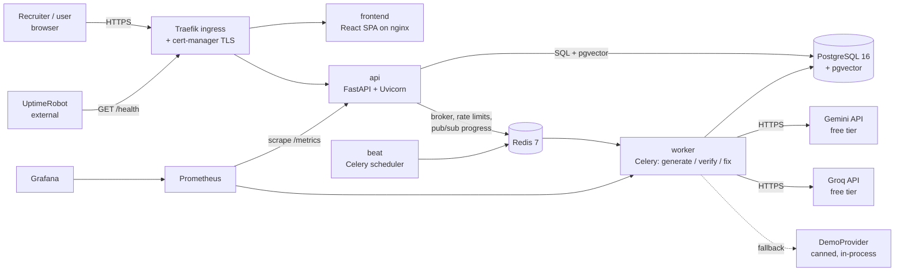
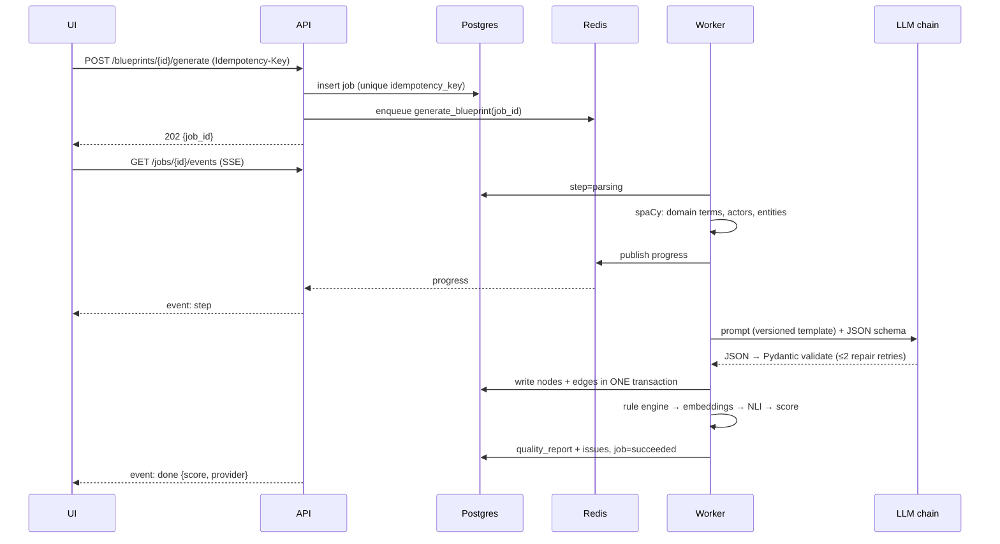
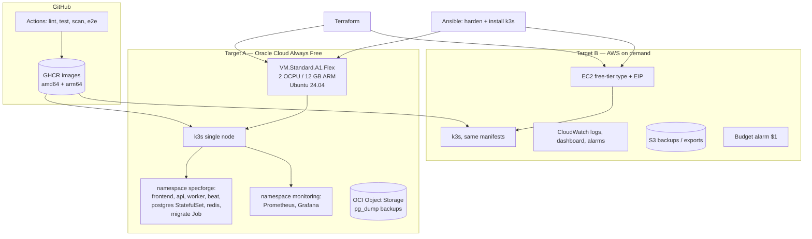

# SPECForge — Architecture

> Status: **Phase 1 draft, awaiting approval.** Sections marked _(planned)_ describe code that does not exist yet.

SPECForge turns a free-text project brief into a **traceable blueprint graph** (requirements → stories → modules → APIs → tables → tests, plus risks), checks it with a deterministic rule engine and two small ML models, scores it 0–100, and tracks delivery against it.

---

## 1. System context



**Processes (one container image per role, same backend image for api/worker/beat):**

| Process | Responsibility |
|---|---|
| `frontend` | Static Vite build served by nginx (non-root, read-only FS). |
| `api` | REST + OpenAPI (`/docs`), auth, RBAC, graph queries, change-impact traversal, SSE job progress, exports, `/health` `/ready` `/metrics` `/status`. Never calls the LLM or loads ML models — keeps the API fast and small. |
| `worker` | Celery worker. Loads spaCy + sentence-transformer + NLI cross-encoder **once per process** (`worker_process_init`). Runs `generate_blueprint`, `verify_blueprint`, `regenerate_subgraph`, `fix_issue`. |
| `beat` | Celery beat: nightly sandbox reset, cache pruning. |
| `migrate` | One-shot Alembic `upgrade head` (k8s Job / compose `depends_on: service_completed_successfully`). |
| `postgres`, `redis` | State. Postgres is the system of record (jobs, results, cache); Redis is broker + rate-limit counters + pub/sub only, so a Redis flush loses no data. |

---

## 2. The generate → verify → trace pipeline



**Steps reported to the UI:** `parsing → generating_requirements → generating_design → generating_tests → saving → rule_check → ml_check → scoring → done`.

Generation is **staged** (ADR-017): three LLM calls with three small schemas, so each fits Groq's 8K tokens/minute free limit, and each can be repaired or re-run on its own.

### 2.1 LLM provider layer
```
LLMProvider (Protocol)
  name: str
  generate_json(prompt: str, schema: type[BaseModel]) -> BaseModel
├── GeminiProvider     app/llm/providers/gemini.py  (REST generateContent + responseJsonSchema)
├── GroqProvider       app/llm/providers/groq.py    (OpenAI-compatible, json_schema strict)
└── DemoProvider       app/llm/providers/demo.py    (4 curated samples, else spaCy-driven templates)
Chain (app/llm/chain.py): exact cache hit → [gemini → groq] per stage → stale cache (same brief,
older prompt) → DemoProvider for the whole blueprint
```
- Each call: render template from `backend/app/llm/templates/<name>.v<N>.md` → call → `schema.model_validate_json` → on `ValidationError`, re-prompt with the error text (max 2 retries) → on provider error/quota (`429`, timeout, 5xx) move to next provider.
- Per-provider circuit breaker in Redis (open for 60 s after a quota error) so we don't hammer a dead provider.
- The provider that answered is stored on the blueprint and shown as a badge in the UI.
- Model IDs are **env config**, not code (free-tier model names churn — see `COSTS.md`).

### 2.2 Verification engine
**Rule layer (pure Python, no I/O, heavily unit-tested):** each rule is a class `Rule(code, category, severity).check(graph) -> list[Issue]`.

| Code | Category | Rule |
|---|---|---|
| TR-001 | Traceability | Every requirement has ≥1 story |
| TR-002 | Traceability | Every story has ≥1 test |
| TR-003 | Traceability | Every API maps to ≥1 module and ≥1 entity |
| TR-004 | Traceability | No orphan nodes (degree 0) |
| CP-001 | Completeness | Every story has ≥1 acceptance criterion (Given/When/Then) |
| CP-002 | Completeness | Every entity has CRUD coverage (create/read/update/delete endpoints or an explicit exemption) |
| CP-003 | Completeness | At least one NFR per category present (performance, security, availability) |
| CP-004 | Completeness | Every high risk has a mitigation edge |
| CV-001 | Conventions | Endpoints: kebab-case plural nouns, verb matches semantics (no `GET /createUser`) |
| CV-002 | Conventions | Entities: PascalCase singular; columns snake_case; each entity has a PK |
| CV-003 | Conventions | Node keys unique and well-formed (`REQ-001`, `US-001`, …) |
| TR-005 | Traceability | Every module implements ≥1 story |

(Implemented in `backend/app/verify/rules.py`: pure functions over a `GraphView` snapshot. CP-001 also flags criteria not in Given/When/Then form at low severity.)

**ML layer:**
- *Duplicates:* `all-MiniLM-L6-v2` (384-d) embeddings stored in `nodes.embedding vector(384)` with an HNSW index. Pairs of same-type nodes with cosine ≥ 0.90 → `DUP-001 duplicate`, 0.80–0.90 → `DUP-002 near-duplicate`. Query uses pgvector `<=>` within the blueprint.
- *Contradictions:* `cross-encoder/nli-deberta-v3-xsmall`. Hybrid (ADR-022): requirement pairs need cosine ≥ 0.45 **and** a polarity cue (negation in one only, antonym prefix, conflicting quantities) before NLI runs in both directions; max P(contradiction) ≥ 0.80 → `CON-001` ("may contradict", dismissible).

**Quality Score (0–100):** weighted category scores.

| Category | Weight | Category score |
|---|---|---|
| Traceability | 35 | `100 × (1 − Σ severity_weight / checks)`; weights high 1.0, medium 0.6, low 0.3 |
| Completeness | 25 | same |
| Consistency (contradictions) | 20 | `100 − 25 × contradictions`, floor 0 |
| Uniqueness (duplicates) | 10 | `100 − 15 × dup − 5 × near-dup`, floor 0 |
| Conventions | 10 | `100 × (1 − violations / checks)` |

Every issue stores the offending `node_ids`, a human explanation and a `fix_hint`; "Fix with AI" enqueues `fix_issue(issue_id)`, which regenerates only those nodes and re-verifies.

### 2.3 Change-impact propagation

> Semantic pruning (ADR-025): `module → api` edges are followed only for APIs whose embedding is ≥ 0.40 cosine-similar to the edited node.
Editing a node (`PATCH /nodes/{id}`) runs a **recursive CTE** over `edges` in the downstream direction (requirement → story → module → API → entity, and test/risk edges that point at any of those), with a visited-set guard against cycles and a depth cap. Results:
1. Affected nodes are marked `stale = true` in the same transaction as the edit, and a `change_event` row records before/after + impacted IDs.
2. The response returns the impacted nodes **grouped by hop distance**, which the UI uses to animate the propagation wave.
3. `POST /blueprints/{id}/regenerate-subgraph {root_node_id}` regenerates just that subgraph, keeping node IDs stable where possible so kanban status survives.

---

## 3. Data model

```mermaid
erDiagram
    users ||--o{ project_members : has
    projects ||--o{ project_members : has
    projects ||--o{ blueprints : contains
    blueprints ||--o{ nodes : contains
    blueprints ||--o{ edges : contains
    nodes ||--o{ edges : "src / dst"
    blueprints ||--o{ jobs : runs
    blueprints ||--o{ quality_reports : scored_by
    quality_reports ||--o{ issues : lists
    users ||--o{ refresh_tokens : owns
    nodes ||--o{ change_events : edited_by

    users { uuid id PK; citext email UK; text password_hash; bool is_admin; bool is_demo; timestamptz created_at }
    refresh_tokens { uuid id PK; uuid user_id FK; text token_hash UK; uuid family_id; timestamptz expires_at; timestamptz revoked_at; uuid replaced_by }
    projects { uuid id PK; text name; text description; bool is_sandbox; timestamptz created_at }
    project_members { uuid project_id PK; uuid user_id PK; enum role "owner|editor|viewer" }
    blueprints { uuid id PK; uuid project_id FK; int version; text brief; jsonb settings; enum status; int quality_score; text provider; text cache_key }
    nodes { uuid id PK; uuid blueprint_id FK; enum type; text key; text title; jsonb body; enum status; bool stale; vector embedding "384"; int position }
    edges { uuid id PK; uuid blueprint_id FK; uuid src_id FK; uuid dst_id FK; enum type }
    jobs { uuid id PK; uuid blueprint_id FK; enum kind; enum status; text step; int progress; text idempotency_key UK; int attempts; jsonb error; jsonb result }
    quality_reports { uuid id PK; uuid blueprint_id FK; int score; jsonb breakdown; timestamptz created_at }
    issues { uuid id PK; uuid report_id FK; text rule_code; enum category; enum severity; text message; uuid_array node_ids; text fix_hint; bool resolved }
    generation_cache { text cache_key PK; text prompt_version; text provider; jsonb payload; timestamptz created_at }
    change_events { uuid id PK; uuid node_id FK; uuid user_id FK; jsonb before; jsonb after; uuid_array impacted }
```

- **Node types:** `requirement` (body.kind = functional | non_functional, body.nfr_category), `story` (body.acceptance_criteria[]), `module`, `api` (body.method, body.path), `entity` (body.fields[], body.relations[]), `test`, `risk` (body.likelihood, body.impact, body.mitigation).
- **Edge types (direction = downstream for impact):** `refines` (requirement→story), `implemented_by` (story→module), `exposes` (module→api), `persists` (api→entity), `relates_to` (entity→entity, with cardinality in body), `verified_by` (story|api→test), `threatens` (risk→requirement|module), `depends_on` (module→module).
- **Statuses:** `todo | in_progress | in_review | done` for stories and tests (kanban); roll-ups are SQL aggregates over `refines`/`implemented_by` edges.
- **Indexes:** `nodes(blueprint_id, type)`, `edges(blueprint_id, src_id)`, `edges(blueprint_id, dst_id)`, unique `edges(src_id, dst_id, type)`, HNSW `nodes.embedding vector_cosine_ops`, unique `jobs.idempotency_key`, `refresh_tokens(token_hash)`.
- **Why relational, not a graph DB:** see ADR-003.

---

## 4. API outline (v1, all under `/api/v1`)

Error envelope everywhere: `{"code": "string", "message": "string", "details": {...}}`. List endpoints: `?limit=&cursor=` + filters.

| Method & path | Role | Notes |
|---|---|---|
| `POST /auth/register`, `POST /auth/login` | public | Argon2id hashes; returns access (15 min) + refresh (7 d, httpOnly cookie) |
| `POST /auth/refresh` | public | Rotating refresh; reuse of a revoked token revokes the whole family |
| `POST /auth/logout` | user | |
| `POST /auth/demo` | public | Issues tokens for a shared demo user (`editor` on the sandbox project), rate-limited |
| `GET /me` | user | |
| `GET/POST /projects`, `GET/PATCH/DELETE /projects/{id}` | viewer / owner | |
| `GET/PUT/DELETE /projects/{id}/members/{user_id}` | owner | |
| `GET/POST /projects/{id}/blueprints` | viewer / editor | |
| `GET /blueprints/{id}` | viewer | metadata + score + provider badge |
| `GET /blueprints/{id}/graph?types=&status=` | viewer | nodes + edges for React Flow |
| `POST /blueprints/{id}/generate` | editor | `Idempotency-Key` header → 202 `{job_id}`; rate-limited per user + IP |
| `POST /blueprints/{id}/verify` | editor | 202 job |
| `GET /blueprints/{id}/quality` | viewer | latest report + issues |
| `POST /issues/{id}/fix` | editor | 202 job |
| `GET/POST /blueprints/{id}/nodes`, `GET/PATCH/DELETE /nodes/{id}` | viewer / editor | PATCH returns impact set |
| `GET /nodes/{id}/trace` | viewer | upstream + downstream chain |
| `GET /nodes/{id}/impact` | viewer | dry-run impact (no stale marking) |
| `POST /blueprints/{id}/regenerate-subgraph` | editor | 202 job |
| `PATCH /nodes/{id}/status` | editor | kanban move |
| `GET /blueprints/{id}/progress` | viewer | roll-ups per requirement / module |
| `GET /blueprints/{id}/export?format=md\|json\|pdf` | viewer | |
| `GET /jobs/{id}`, `GET /jobs/{id}/events` | viewer | SSE stream; falls back to polling |
| `GET /samples` | public | the 4 pre-generated sample blueprints (read-only) |
| `GET /health` | public | liveness, no dependencies |
| `GET /ready` | public | DB + Redis + worker heartbeat (models loaded) |
| `GET /status` | public | per-component health, provider health, version, commit SHA, CI run link |
| `GET /metrics` | cluster-internal | Prometheus |

RBAC is a FastAPI dependency `require_role(project_id, min_role)` with `viewer < editor < owner`, `admin` bypass; every endpoint above has an allow + deny test.

---

## 5. Deployment topology



**Memory budget on the 12 GB VM (requests / limits, to be measured in Phase 6):**

| Component | Request | Limit |
|---|---|---|
| k3s + Traefik + cert-manager + metrics-server | ~0.8 GB | — |
| postgres | 512 Mi | 1.5 Gi |
| redis | 64 Mi | 256 Mi |
| api ×2 (HPA 1–3) | 256 Mi | 512 Mi |
| worker (concurrency 2, models loaded once) | 1 Gi | 2 Gi |
| beat | 64 Mi | 128 Mi |
| frontend | 32 Mi | 64 Mi |
| prometheus + grafana | 384 Mi | 1 Gi |
| **Total limits** | | **≈ 7.5 GB**, leaves headroom |

Note: Oracle reclaims Always Free instances that are idle (p95 CPU, network **and** memory all < 20 % over 7 days). Our resident memory stays above 20 % of 12 GB, and uptime checks + Prometheus scraping produce constant activity.

---

## 6. Repository layout (planned)

```
specforge/
├── backend/        app/{api,core,db,models,schemas,services,graph,rules,ml,llm,tasks}, alembic/, tests/
├── frontend/       src/{pages,components,graph,api,hooks}, tests/, e2e/
├── infra/terraform/{oracle,aws}/   infra/ansible/{roles,playbooks}
├── deploy/k8s/ (kustomize base + overlays: oracle, aws, local)   deploy/swarm/docker-stack.yml
├── .github/workflows/  ci.yml, cd.yml, infra.yml, nightly.yml
├── docs/           ARCHITECTURE, DECISIONS, COSTS, AWS, RUNBOOK, API, RESUME_MAPPING
├── docker-compose.yml   Makefile   PROGRESS.md   README.md
```
